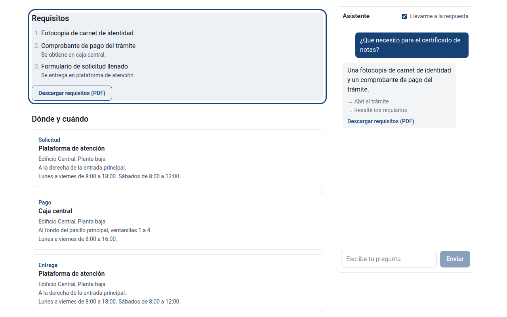

# ragnavigator

A catalog site for an institution's procedures (trámites) and services, with an assistant
that doesn't just answer: it takes you to where the answer lives. Ask "¿Qué necesito para el
certificado de notas?" and the site opens that procedure, scrolls to its requirements,
highlights them, and offers the requirements as a PDF.



The demo is a fictional university, Universidad Nueva Cordillera, with its content in
Spanish. The assistant runs on a local LLM and is built on
[ragstarter](https://github.com/jpmenach/ragstarter), my RAG engine, used here as a library.

## Status

| Phase | Scope | State |
|---|---|---|
| 1 | Catalog site: procedures, places, requirements PDF, per-organization theme | Done |
| 2 | Index the catalog, `/api/ask`, evaluation | Done |
| 3 | Assistant panel; the site navigates and highlights on its own | Done |
| 4 | Admin: login, editing, re-indexing on save, unanswered questions | Planned |

## How it works

```
                    ┌──► page (/entries/certificado-de-notas)   what people read
catalog (SQLite) ───┤
                    └──► one document per section ──► ragstarter index (bge-m3 + Chroma)
                         + where it lives: /entries/certificado-de-notas#requirements

question ──► ragstarter: retrieve, check relevance, answer from the context only (Ollama)
                │
                └─► top source's route ──► actions: navigate, highlight, offer the PDF
                                                │
                                   React runs them: the page moves on its own
```

- **The catalog is the only source of truth.** Pages and the assistant read the same
  records, so they can't disagree. The vector index is a copy that can be rebuilt at any
  time.
- **The LLM answers; code decides where to go.** Each indexed section carries its page
  route, and the actions come from the top source's route. The model never writes a URL,
  so every route the assistant uses exists.
- **Every action only shows something** (navigate, highlight, offer a download). None
  changes data, so they run without asking. A checkbox turns automatic navigation off;
  answers then suggest the section with a button instead.

## Design decisions

- **One document per section, with a single heading naming both the entry and the
  section** (`# Certificado de notas: requisitos`). ragstarter splits at every heading,
  so nested headings left the requirements chunk without the entry's name, and
  near-identical procedures became indistinguishable.
- **Section ids are a contract.** `#requirements`, `#where-and-when`, `#notes` are what
  the assistant scrolls to and highlights. Everything fixed by code (routes, ids) is
  English; slugs are content and stay in the catalog's language
  (`/entries/certificado-de-notas`).
- **No persona in the prompt.** A Spanish persona fixed answers coming back in English,
  but it also weakened ragstarter's grounding rules: the model wrote "NO." instead of the
  `NO_ANSWER` sentinel, and turned "Bs" into dollars. Without a persona the answer
  language is still right, and the evaluation went from 18–19 to 19–20 of 21.
- **Content wording matters as much as the prompt.** "800 Bs" was answered as "$800" in 6
  of 6 tries; "800 bolivianos (Bs)" was right in 6 of 6. The fix went into the catalog,
  not into code.
- **SQLite and SQLAlchemy, Chroma for vectors.** One organization, rare edits, many
  reads: SQLite's sweet spot. pgvector would keep vectors and rows in one transaction,
  but with a few hundred chunks and no Postgres, a rebuildable Chroma index is simpler.
- **The organization's color is applied at runtime.** Every color class compiles to a CSS
  variable, so the brand color from the database re-themes the site without a rebuild.
  Text on that color is white or black, whichever contrasts more (WCAG luminance). The
  color is validated as `#rrggbb` before it can reach the stylesheet.
- **ragstarter stays a separate package.** Two projects on one engine is the proof that
  it's reusable. ragnavigator drove the two engine changes it needed: chunk metadata in
  results, and indexing documents built in memory.

## Evaluation

`examples/universidad-demo/scripts/query_test.py` asks 21 questions in Spanish and English:
12 the catalog answers (each answer must contain the key facts, and its top source must be
the right entry and section), 6 about the university that the catalog doesn't cover, and 3
off-topic.

Current result with `llama3.1:8b`: **19–20 of 21**, and **the top source was the right
section in 12 of 12 cases on every run**, which is what navigation depends on. The LLM isn't
fully deterministic: run it more than once before trusting a result.

Top-1 similarity by group: answerable 0.49–0.61, uncovered 0.34–0.53, off-topic 0.23–0.25.
ragstarter's 0.30 threshold separates off-topic questions; uncovered ones overlap with
answerable ones, so only the LLM's own check can tell them apart.

The browser tests (`frontend/e2e/`, Playwright) check what the interface does with an
answer: navigation, highlight, PDF link, suggest mode, the phone layout. They replace
`/api/ask` with fixed answers, so they're deterministic; answer quality is the evaluation's
job.

## Known limitations

All with the local `llama3.1:8b`.

- **Answers sometimes leave items out.** "¿Qué necesito para el certificado de notas?" is
  often answered with two of its three requirements (the screenshot above is one of
  those). The page the assistant opens shows the full list highlighted, so the chat
  answer works as a summary, not as the only source.
- **Occasional false refusals.** The same answerable question was refused once in 20
  tries, with the right section ranked first.
- **Yes/no misreadings.** "¿El gabinete médico atiende emergencias?" gets a bare "No",
  though the catalog says first aid yes, serious emergencies go to the hospital.
- **One destination per answer.** Navigation follows the top source only. A question
  about two places ("where do I request it and where do I pay?") opens one of them.
- **No admin yet.** The catalog is edited in `examples/universidad-demo/data/catalog.json`
  and loaded with the seed script; the index is rebuilt by hand. Restart the server after
  rebuilding the index: a running server keeps the old one loaded, and its next answer
  fails.

## Running it

Requirements: Python 3.12 and [uv](https://docs.astral.sh/uv/), Node 22.22 or newer, and
[Ollama](https://ollama.com) with the model pulled (`ollama pull llama3.1:8b`).
ragstarter is installed from a sibling folder during development, so clone both side by
side:

```bash
git clone https://github.com/jpmenach/ragstarter
git clone https://github.com/jpmenach/ragnavigator
cd ragnavigator
uv sync
uv run python -m ragnavigator.seed examples/universidad-demo/data/catalog.json
uv run python -m ragnavigator.indexing     # first run downloads bge-m3 (~2.3 GB)
```

Development, with hot reload (two terminals):

```bash
uv run fastapi dev src/ragnavigator/main.py
cd frontend && npm install && npm run dev  # http://localhost:5173
```

Production-like, one process (FastAPI also serves the built frontend):

```bash
cd frontend && npm run build && cd ..
uv run fastapi run src/ragnavigator/main.py   # http://localhost:8000
```

Tests and evaluation:

```bash
uv run python examples/universidad-demo/scripts/query_test.py   # needs Ollama
cd frontend && npx playwright install chromium && npm run test:e2e
# on Linux, Chromium also needs system libraries (once):
#   sudo env "PATH=$PATH" npx playwright install-deps chromium
```

## Project layout

```
src/ragnavigator/
  db.py          SQLite engine (WAL, foreign keys on) and the per-request session
  models.py      catalog: organization, categories, entries, requirements, places
  schemas.py     what the API takes and returns, including the action types
  seed.py        load a catalog JSON into SQLite (drops and recreates the tables)
  indexing.py    catalog → one document per section, with its route → ragstarter index
  assistant.py   ask the index (ragstarter's answer())
  actions.py     top source → navigate / highlight / offer_download
  pdf.py         requirements sheet per entry (fpdf2)
  main.py        FastAPI: catalog API, /api/ask, PDFs, and the built frontend
examples/universidad-demo/
  data/catalog.json         the fictional university's content (Spanish)
  scripts/query_test.py     evaluation
frontend/
  src/pages/                home, entry, locations
  src/components/AssistantPanel.tsx   the chat panel; runs the actions
  src/assistantActions.ts   log lines, suggestion labels, the highlight
  src/theme.ts              organization color at runtime, text contrast
  e2e/                      Playwright tests
  demo/record.ts            records the demo clip against the real assistant
```
